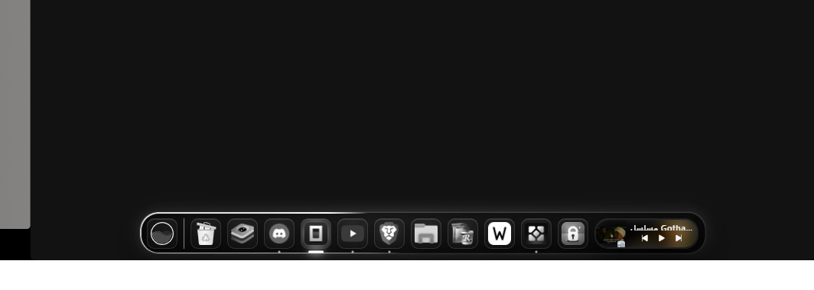
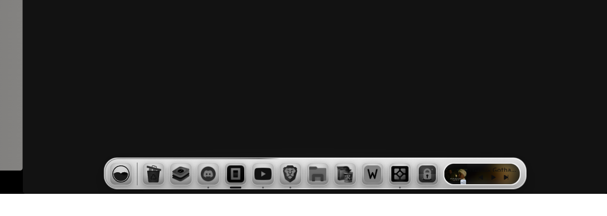
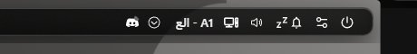
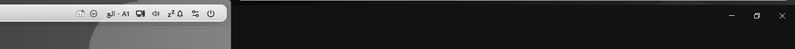
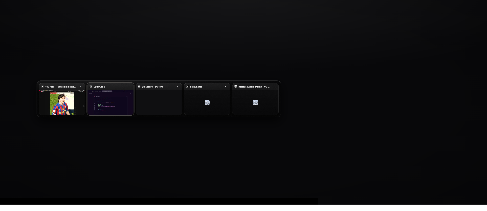
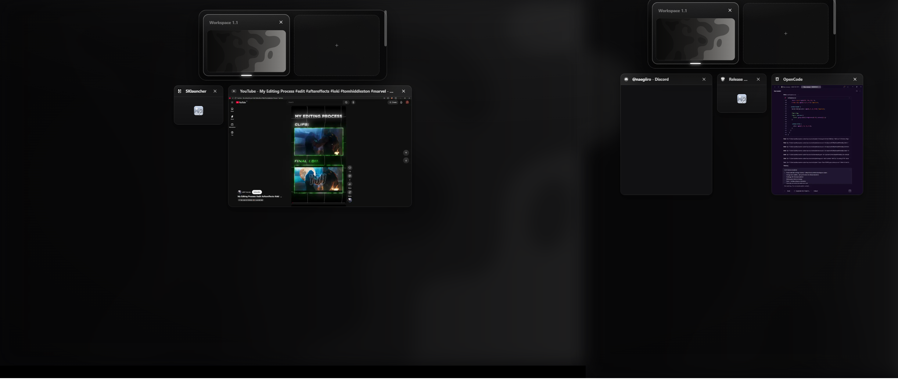
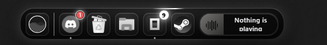

# Aurora Dock

هوية **أحادية اللون** لـ Seelen UI: زجاج داكن/فاتح، لمعات بيضاء فقط، وحركات هادئة.
يعمل على Windows 10 و 11 مع Seelen UI 2.8.x.

> **الموقع:** [aurora-dock.babfialbi91.workers.dev](https://aurora-dock.babfialbi91.workers.dev) — زر تحميل يجلب أحدث `.slu` مباشرة.



## المحتويات

| المسار | الوصف |
| --- | --- |
| `aurora-dock/` | الثيم نفسه (`metadata.yml` + `styles/*.scss` لكل وجت). |
| `wallpapers/` | 12 خلفية مونوكروم 3840×2160 (JPG) + معاينات. |
| `iconpack/` | حزمة أيقونات رمادية لتطبيقات الدوك (`@user/aurora-mono`). |
| `scripts/` | بناء الحزمة، الإصدار، الخلفيات، حزمة الأيقونات، مزامنة التراي، وضع الدمج، بروفايل البطارية. |
| `dist/aurora-dock.slu` | الحزمة الجاهزة للتركيب (ناتج البناء). |
| `docs/screenshots/` | لقطات الوضع الداكن والفاتح. |

## التركيب

**كملف حزمة (.slu)** — من صفحة [Releases](../../releases) نزّل `aurora-dock.slu` ثم اسحبه على نافذة Seelen UI.

**كمجلد** — انسخ `aurora-dock/` إلى:

```
%APPDATA%\com.seelen.seelen-ui\themes\aurora-dock
```

ثم من إعدادات Seelen: `Themes → Aurora Dock`، وأعد تشغيل Seelen.

> الثيم لا يُعاد تحميله تلقائياً: أغلق `seelen-ui` من مدير المهام وافتحه من جديد بعد أي تعديل.

## المزايا

- **دوك زجاجي** مع موجة تكبير، لمعان أورورا على الحافة، وحركة ضغط مطاطية.
- **مونوكروم صارم**: كل الأيقونات رمادية، وتعود الألوان عند التمرير/التركيز فقط.
- **وضع نهاري** يتبع `prefers-color-scheme` في Windows (زجاج أبيض + حبر داكن).
- **Spotlight**: البلاطة تحت المؤشر تُضاء من الأسفل وجاراتها تأخذ هالة خفيفة.
- **حركة دخول** للدوك والشريط عند تشغيل Seelen (تُحترم `prefers-reduced-motion`).
- **Alt+Tab** و**مساحات العمل** بتصميم بطاقات زجاجية موحّد.
- **إشعارات** ككروت زجاجية بحدّ مضيء وحركة ظهور منزلقة.
- **العربية**: أرقام جدولية و`unicode-bidi: plaintext` للنصوص المختلطة.
- **دمج مع شريط ويندوز**: وضع «سطح نظيف» يخفي شريط المهام بهدوء ويترك الحافتين للدوك والشريط العلوي.
- **بروفايل بطارية**: نفس الهوية بلا ضباب وبحركة هادئة، من أمر واحد.

| داكن | فاتح |
| --- | --- |
|  |  |
|  |  |




## على الجهاز

لقطات حقيقية من الشاشة، بلا نماذج ولا تركيب.

| الشاشة الأساسية (1920×1200) | الشاشة الثانية (1024×1280) |
| --- | --- |
|  |  |

## الدمج مع شريط ويندوز

Seelen 2.8 لا يملك موديول taskbar خاصاً به، فـ«الدمج» يعني أن يتولّى الدوك الحافة السفلية
والشريط العلوي الحافة العليا، وأن يتحوّل شريط ويندوز إلى شريط يُخفى تلقائياً ويعود بحركة
ناعمة عند لمس الحافة — بلا نافذة مزدوجة ولا شريط مكرّر.

```powershell
powershell -File scripts/shell-mode.ps1            # إخفاء تلقائي (موصى به)
powershell -File scripts/shell-mode.ps1 -Mode hide # إخفاء كامل للجلسة
powershell -File scripts/shell-mode.ps1 -DryRun    # معاينة بلا تغيير
powershell -File scripts/shell-mode.ps1 -Undo      # استعادة كل شيء
```

- يحفظ الحالة السابقة في `%LOCALAPPDATA%\aurora-dock\shell-state.json`.
- يضبط `position`/`margin`/`padding` للدوك والشريط إن انحرفت عن شبكة 8px.
- لا يمسّ الملفات الشخصية ولا خلفيات النظام.

> بعد الإغلاق المفاجئ لـSeelen استخدم `-Undo` ثم أعد التطبيق: السكربت يحفظ «أقدم» لقطة فقط.

## وضع البطارية

بروفايل اختياري يبقي الأشكال والأيقونات وموجة التكبير، ويلغي ما يستهلك البطارية فقط
(الضباب، اللمعان المتكرّر، التوهّج):

```powershell
powershell -File scripts/low-profile.ps1            # low  (ضباب 0، حركة 15%)
powershell -File scripts/low-profile.ps1 -Profile high
powershell -File scripts/low-profile.ps1 -Undo      # يعيد القيم السابقة
```

القيم تُكتب في `settings.json` داخل `byTheme["@asfkep/aurora-dock"]`، ويعيد السكربت تشغيل
Seelen بعد الكتابة. للعودة يدوياً: من إعدادات الثيم أعد `--ads-fx` إلى 100 و`--ads-blur` إلى 22.

## الإعدادات

تظهر داخل Seelen تحت إعدادات الثيم، وكلها متغيّرات CSS حقيقية:

| المتغيّر | الافتراضي | الوظيفة |
| --- | --- | --- |
| `--ads-opacity` | `62` | عتامة الزجاج (%) |
| `--ads-blur` | `22` | قوة الضباب (px) |
| `--ads-radius` | `24` | استدارة الحواف (px) |
| `--ads-zoom-size` | `84px` | حجم الأيقونة تحت المؤشر (ضعه = حجم العنصر لإيقاف الموجة) |
| `--ads-wave-duration` | `160` | زمن موجة التكبير (ms) |
| `--ads-speed` | `14` | سرعة دوران اللمعان (s) |
| `--ads-glow` | `58` | شدّة التوهّج الأبيض |
| `--ads-motion` | `100` | شدّة الحركات الزخرفية (0 = إيقاف) |
| `--ads-fx` | `100` | ميزانية المؤثرات: يقلّل/يوقف الضباب لتوفير البطارية |

## الخلفيات

مجموعة **«دراسات ضوء»**: كل خلفية دراسة لشكل ضوء واحد على سطح مطفي، داخل نطاق سطوع
واحد — لا أبيض محروق ولا أسود كامل (أدنى درجة ≈ 26/255)، مع حبيبات فيلمية ناعمة
ومقاومة للـbanding.

| داكنة | | | |
| --- | --- | --- | --- |
| `01-seam` درز ضوء | `02-orb` كرة ضوء | `03-dunes` كثبان | `04-lattice` شبكة نقط |
| `05-eclipse` كسوف | `06-monolith` لوح | `07-silk` حرير | `08-contour` كنتور |
| `09-prism` ألواح زجاج | `10-beacon` عمود ضوء | | |

| فاتحة | |
| --- | --- |
| `11-paper` ورق بثنية | `12-mist` ضباب وأفق |

المعاينات في `wallpapers/previews/` (و`00-set.jpg` لوحة تجميعية).

**تطبيق خلفية** (يحترم الشاشتين):

```powershell
powershell -File scripts/apply-wallpaper.ps1 09-prism
powershell -File scripts/apply-wallpaper.ps1 11-paper -Position Span
```

**إعادة التوليد** (numpy + Pillow، حوالي 40 ثانية):

```powershell
python scripts/make-wallpapers-v3.py
python scripts/make-wallpapers-v3.py --only 05,09
```

> إن ظهرت خلفية سوداء على سطح المكتب، فهي طبقة Seelen وليست الصورة:
> عطّل `@seelen/wallpaper-manager` من إعدادات Seelen (أو اجعل `defaultCollection` فارغاً)
> وأعد تشغيل Seelen.

## حزمة الأيقونات

`iconpack/` تبني حزمة `@user/aurora-mono` من تطبيقات الدوك المثبّتة (256px ثم إزالة تشبع):

```powershell
powershell -File scripts/build-iconpack.ps1 -Install
```

بعدها فعّلها من Seelen: `Icon Packs → Aurora Mono`. (الحزمة تغطي تطبيقات الدوك؛ البقية تبقى من `@system/icon-pack`.)

## البناء والإصدار

```powershell
# حزمة .slu فقط
python scripts/build-slu.py

# إصدار كامل: بناء .slu + حزمة الخلفيات + commit + push + GitHub Release + tag
# (يستخدم docs/release-notes/vX.Y.Z.md إن وُجد، وإلا changelog تلقائي)
powershell -File scripts/release.ps1            # أضف -DryRun للمعاينة
```

الـworkflow `release.yml` يبني الحزمة وينشرها تلقائياً عند دفع أي tag يبدأ بـ`v`،
و`ci.yml` يصرّف كل ملفات SCSS عند كل push.

## ملاحظات

- بعض الأسطح (ضوضاء الزجاج، البطاقات) تعتمد على `backdrop-filter`؛ إن لاحظت بطئاً خفّض `--ads-fx` أو `--ads-blur`.
- الثيم لا يعدّل النوافذ العادية في Windows؛ يخصّ واجهات Seelen فقط.
